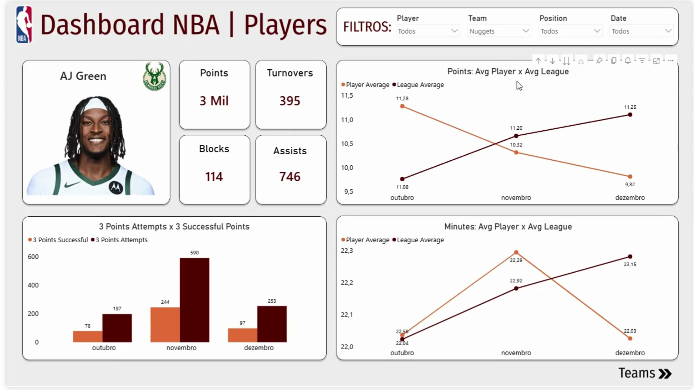
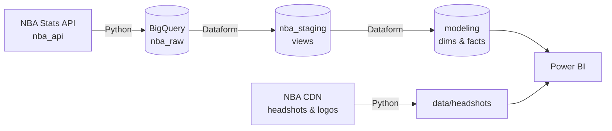
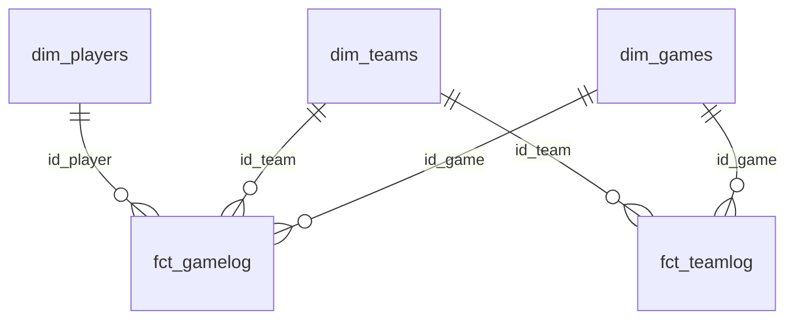
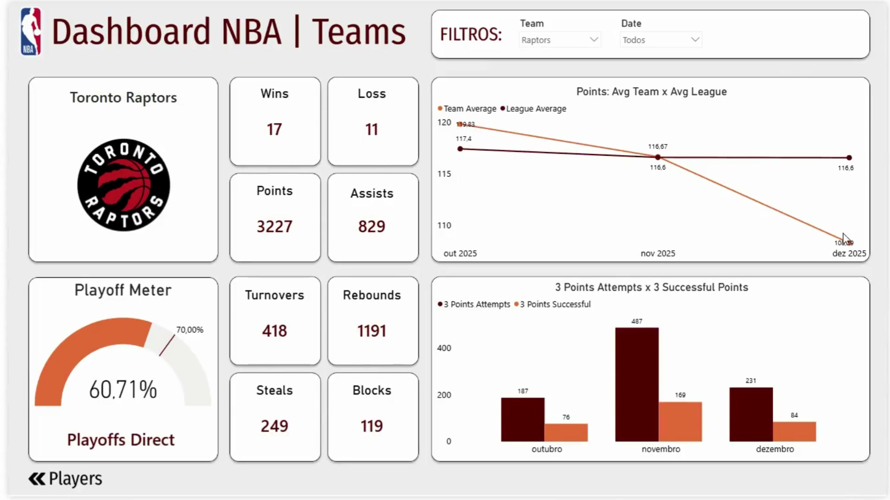

# 🏀 NBA Analytics Pipeline

End-to-end analytics project on official NBA data: a Python pipeline extracts the season from the NBA Stats API, loads it into **BigQuery**, models it with **Dataform** (staging → marts, with data-quality tests) and feeds a **Power BI** dashboard comparing players and teams against the league.



## Architecture



One command runs everything: `python main.py` extracts, loads, runs the Dataform models and their tests.

| Layer | Dataset | What happens there |
|---|---|---|
| Raw | `nba_raw` | API responses as-is, plus an `_ingested_at` column. Full refresh per run. |
| Staging | `nba_staging` (views) | Renaming to `snake_case`, type casting (dates, heights in cm), home/away flag. |
| Marts | `modeling` (tables) | Star schema consumed by Power BI. |

## Data model



| Table | Grain | Rows (2025-26) |
|---|---|---|
| `fct_gamelog` | player × game | 26,651 |
| `fct_teamlog` | team × game | 2,460 |
| `dim_games` | game | 1,230 |
| `dim_players` | player who played in the season | 582 |
| `dim_teams` | franchise | 30 |

The calendar dimension used by the report is built inside Power BI.

## Data quality

The Dataform run includes **21 assertions**, and the pipeline stops if any of them fails:

- **Uniqueness and not-null** on every key, in staging and marts.
- **Referential integrity**: every player and team in the facts exists in the dimensions.
- **Reconciliation between sources**: for every game, the sum of the players' points equals the team's points (player and team box scores come from different API calls).
- **Game consistency**: exactly two teams and one winner per game.

The tests already caught a real edge case. Five games were played on **neutral courts**: the two NBA Cup semifinals in Las Vegas and the games in Mexico City, Berlin and London. In those games the API lists *both* teams as visitors (`@`). `dim_games` flags them with `is_neutral_site` and always fills the winner/loser columns, so no game is lost when you analyze home-court advantage.

## Design decisions

- **One request instead of ~530.** Player game logs come from `LeagueGameLog` in player mode (the whole league in a single call) instead of looping `PlayerGameLog` per player. Same rows, same totals, and a full run takes about a minute.
- **Players come from the season, not from "active today".** The static `nba_api` player list flags who is active *now*. Building `dim_players` from it drops players who played the season and retired afterwards, and leaves their games orphaned. The dimension is built from the players who appear in the game logs, enriched by `PlayerIndex` in historical mode, which covers 582 of 582 players.
- **Traded players.** `id_team` lives in the fact (team at the time of the game). In `dim_players` it means the team of the player's last game. 72 players changed teams during 2025-26.
- **Nothing environment-specific in the code.** The project id comes from `.env`. The Dataform credentials file is generated on each run from the same variables.

## How to run

Prerequisites: Python 3.10+, Node.js, a Google Cloud project (the free [BigQuery Sandbox](https://cloud.google.com/bigquery/docs/sandbox) is enough) and the `gcloud` CLI.

```bash
git clone https://github.com/RodrigoJacquesW/nba_project.git
cd nba_project

python -m venv .venv && source .venv/bin/activate
pip install -r requirements.txt
npm install -g @dataform/cli@3.0.38

gcloud auth application-default login
cp .env.example .env          # set GCP_PROJECT_ID

python main.py                # extract + load + Dataform models and tests
python main.py --images       # also download missing headshots and logos
python main.py --season 2024-25
```

> **BigQuery Sandbox:** tables expire after 60 days. Run `python main.py` again to rebuild them.

## Repository structure

```
├── main.py                  # entry point (CLI)
├── src/nba_pipeline/
│   ├── config.py            # settings from .env
│   ├── extract.py           # NBA Stats API calls
│   ├── load.py              # BigQuery load (raw)
│   ├── images.py            # headshots and logos
│   └── transform.py         # runs Dataform
├── definitions/
│   ├── sources/             # raw table declarations
│   ├── staging/             # stg_* views
│   ├── marts/               # dim_* and fct_* tables
│   └── assertions/          # cross-table data tests
├── workflow_settings.yaml   # Dataform config (project id comes from .env)
├── data/headshots/          # player headshots + teamsheadshot/ (team logos), used by Power BI
├── powerbi/nba_dashboard.pbix
└── docs/img/
```

## Dashboard

Two pages, **Players** and **Teams**, each comparing the selection with the league average: points, minutes, 3-point attempts vs. makes, and a *Playoff Meter* that classifies the team (playoffs direct, play-in, out) from its win percentage.



*Screenshots taken in December 2025, mid-season. The pipeline now loads the full 2025-26 regular season.*

## Next steps

- Incremental loads by game date instead of full refresh.
- Scheduled runs (GitHub Actions or Cloud Scheduler).
- Playoff games (`season_type_all_star="Playoffs"`).

---

**Rodrigo Jacques Wolff** · Analytics Engineer · [LinkedIn](https://www.linkedin.com/in/rodrigo-jacques-wolff/)
